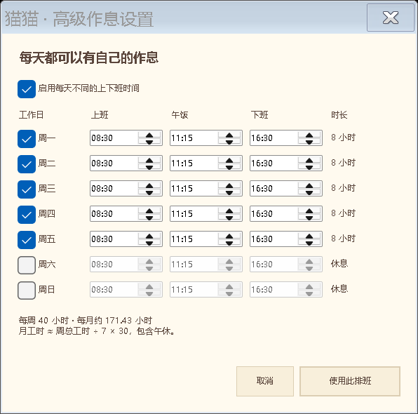

# 猫猫等下班 · Offwork Cat

一个小小的 Windows 桌面猫猫，陪你等午饭、等下班。

## 实机效果

下面是 Windows 实际运行截图；桌宠和菜单仅截取应用自身，不包含其他桌面窗口。

| 桌宠与秒级倒计时 | 奶油色右键菜单 |
| --- | --- |
|  |  |

### 高级排班设置

默认排班示例，可为每一天单独设置上班、午饭、下班时间和休息日。



## 使用

下载 [`download/OffworkCat.exe`](download/OffworkCat.exe)，放进有写入权限的文件夹后双击运行，无需安装。更新前先右键退出旧猫。

- 透明桌宠，约 210 × 160 逻辑像素；可拖动、置顶和缩放，无椭圆阴影。
- 10 种猫猫：休闲、跳舞、思考、摸鱼、开心、脚脚摸鱼、不想上班、不玩啦、光速下班、生气。
- 右键切换猫猫，或每分钟随机换；原始透明动画及逐帧时长保留在程序内。
- 午饭与下班倒计时精确到秒，到点庆祝 8 秒；下班庆祝使用光速下班动画。
- 单击显示上班进度饼图，3 秒后收起；3 秒内继续点击切换到今日已赚。
- 奶油色右键菜单、作息设置和工资设置；支持 100%、150%、200% 显示缩放。

## 作息和工资

默认周一至周五 08:30–16:30，午饭 11:15。

右键 → 设置作息时间 → 高级设置，可为周一到周日分别设置工作/休息、上班、午饭和下班时间。先点“使用此排班”，再保存作息窗口。

右键 → 设置工资，填写月薪。计算方式：

```text
一周总工时 = 七天排班时长之和，休息日计零
估算月工时 = 一周总工时 ÷ 7 × 30
时薪 = 月薪 ÷ 估算月工时
今日已赚 = 时薪 × 当天已过的工作时长
当天总收入 = 时薪 × 当天排班工时
```

包含午休，上班前和休息日不累计，下班后停止。不计算额外加班或实际扣款。工资和排班只写入本机 EXE 同目录的 `settings.xml`，仓库不包含个人设置。

## 构建和检查

在 Windows PowerShell 中执行：

```powershell
powershell -ExecutionPolicy Bypass -File ./build.ps1
powershell -ExecutionPolicy Bypass -File ./build.ps1 -SelfTest
```

使用 Windows 自带的 .NET Framework C# 编译器和 WinForms，无需下载编译依赖。应用输出到 `dist/OffworkCat.exe`。自检覆盖计薪、逐日排班、倒计时、庆祝节点、设置保存及动画资源。

`assets/source/` 保留原始 WebP，`assets/frames/` 为程序嵌入的无损 PNG 帧包；十种动画共 212 帧。

## 素材说明

本项目为非官方粉丝作品，仅供个人学习与交流，请勿用于商业用途。

项目中月薪猫角色及动画素材的版权归原作者及相关权利人所有，本项目与原作者无隶属或合作关系。

如有侵权，请通过 [Issues](https://github.com/Morgiana02/offwork-cat/issues) 联系，我们会及时核实并处理相关内容。
